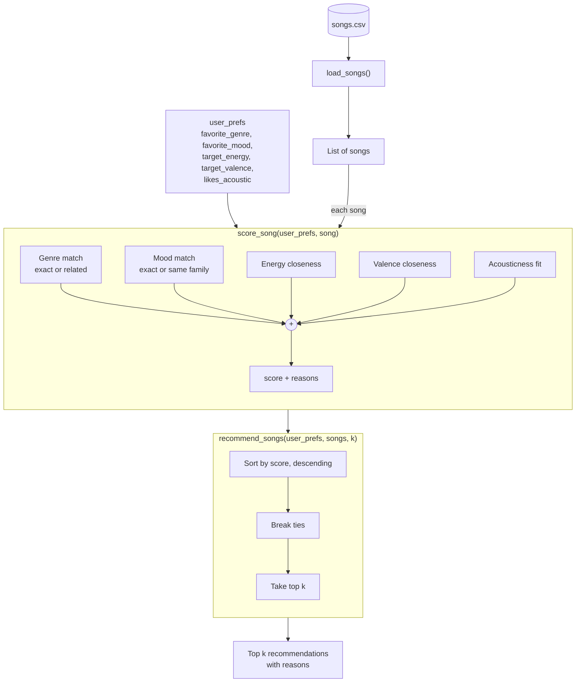

# 🎵 Music Recommender Simulation

## Project Summary

In this project you will build and explain a small music recommender system.

Your goal is to:

- Represent songs and a user "taste profile" as data
- Design a scoring rule that turns that data into recommendations
- Evaluate what your system gets right and wrong
- Reflect on how this mirrors real world AI recommenders

Replace this paragraph with your own summary of what your version does.

---

## How The System Works

Explain your design in plain language.

## How The System Works

### How real recommenders work

Platforms like Spotify and YouTube predict what you'll like next by combining
two approaches. **Collaborative filtering** learns from the behavior of many
users — plays, skips, saves, likes, playlist adds, watch time — and recommends
what people with similar habits enjoyed ("listeners like you also played…").
**Content-based filtering** describes each item by its own attributes — genre,
mood, tempo, energy, and audio features extracted from the sound itself — and
recommends items similar to what you already like. Real systems are hybrids:
collaborative filtering finds surprising connections, while content-based
filtering can recommend brand-new songs nobody has played yet (the "cold start"
problem).

Every recommender has three separate parts:

1. **Input data** – what the system knows about each song (its features).
2. **User preferences** – what the system knows about the listener (a taste
   profile, or at scale, their listening history).
3. **Ranking / selection** – how the system scores each song against the user
   and decides which ones to show, in what order.

### What my version does

My simulation is a **content-based** recommender. It has no other users to
learn from, so it compares each song's features directly against one user's
taste profile.It balances **how a song is labeled** (genre and mood, up to 4.5 points)
slightly above **how it sounds** (energy, valence, acousticness, up to 4.0
points). That way the numbers rank songs within a genre or mood, but a song
with no matching labels can't beat one that matches both. Energy and valence together capture a song's
"vibe": energy is how intense it feels, valence is how positive it feels.


### Features used

**`Song`**
- `genre` – category (pop, lofi, rock, …)
- `mood` – category (happy, chill, intense, …)
- `energy` – 0–1, how intense the song feels
- `valence` – 0–1, how positive/happy it sounds
- `acousticness` – 0–1, acoustic vs. electronic
- (`tempo_bpm` and `danceability` are kept in the data but not scored — in this
  dataset they are almost perfectly correlated with energy, so scoring them
  would count "intensity" several times.)

**`UserProfile`**
- `favorite_genre` – the genre they want
- `favorite_mood` – the mood they want
- `target_energy` – preferred energy level (0–1)
- `target_valence` – preferred positivity (0–1)
- `likes_acoustic` – True/False, converted to a target acousticness of 0.8 / 0.2

### Algorithm Recipe

**Scoring Rule** (one song vs. one user, max 10 points):

| Feature | Points |
|---|---|
| Genre | +2.5 exact match · +1.25 related genre (pop ↔ indie pop) |
| Mood | +2.0 exact match · +1.0 same mood family (chill / relaxed / focused) |
| Energy | up to +3.0, based on closeness to the target |
| Valence | up to +2.0, based on closeness to the target |
| Acousticness | up to +0.5, based on closeness to the target |

Closeness uses a bell curve (Gaussian): a song within about 0.15 of the user's
target gets nearly full points, and the score drops off quickly beyond that. This
rewards songs that are *close* to what the user wants, not simply higher or lower.

**Ranking Rule** (all scored songs → final list):
1. Score every song in the catalog.
2. Sort from highest to lowest score.
3. Break ties by smallest energy distance, then by song id.
4. Return the top *k* songs (default 5), each with the reasons behind its score.

The scoring rule judges each song on its own. The ranking rule judges the list
as a whole, which is why decisions like "don't repeat the same artist" belong
there and not in the score.
### Data flow



Example: for the profile above, *Library Rain* (lofi, chill, energy 0.35)
scores about **8.37 / 8.5**, while *Storm Runner* (rock, intense, energy 0.91)
scores about **1.38 / 8.5**.

### Expected biases

- **Genre imbalance:** lofi has the most songs *and* two related genres (jazz,
  ambient), so lofi listeners get many more good matches than others.
- **Unequal partial credit:** classical, reggae, and latin have no related
  genres, so fans of those get either one exact match or nothing.
- **Narrow profile:** a single `favorite_genre` means most songs earn 0 genre
  points. A user who likes two genres can't express that.
- **Double counting:** mood families and valence partly measure the same thing
  (a "sad" match plus low valence), so emotionally labeled songs get rewarded twice.
- **Conflicting preferences:** a user who wants "rock" but also "chill, low
  energy" may get no rock songs at all, because mood + energy outweigh genre.
- **Filter bubble:** nothing stops the top 5 from being all one genre or one
  artist. I plan to address this with a diversity rule in the ranking step.

---

## Getting Started

### Setup

1. Create a virtual environment (optional but recommended):

   ```bash
   python -m venv .venv
   source .venv/bin/activate      # Mac or Linux
   .venv\Scripts\activate         # Windows

2. Install dependencies

```bash
pip install -r requirements.txt
```

3. Run the app:

```bash
python -m src.main
```

### Running Tests

Run the starter tests with:

```bash
pytest
```

You can add more tests in `tests/test_recommender.py`.

---

## Sample Recommendation Output

Paste a sample of your recommender's output here as a text block so a reader can see what it produces:

```
# e.g.:
# User profile: genre=indie, mood=chill, energy=low
# Recommendations:
#   1. ...
#   2. ...
#   3. ...
```

**Screenshot or video** *(optional)*: <!-- Insert a screenshot or demo video link here -->

---

## Experiments You Tried

Use this section to document the experiments you ran. For example:

- What happened when you changed the weight on genre from 2.0 to 0.5
- What happened when you added tempo or valence to the score
- How did your system behave for different types of users

---

## Limitations and Risks

Summarize some limitations of your recommender.

Examples:

- It only works on a tiny catalog
- It does not understand lyrics or language
- It might over favor one genre or mood

You will go deeper on this in your model card.

---

## Reflection

Read and complete `model_card.md`:

[**Model Card**](model_card.md)

Write 1 to 2 paragraphs here about what you learned:

- about how recommenders turn data into predictions
- about where bias or unfairness could show up in systems like this


