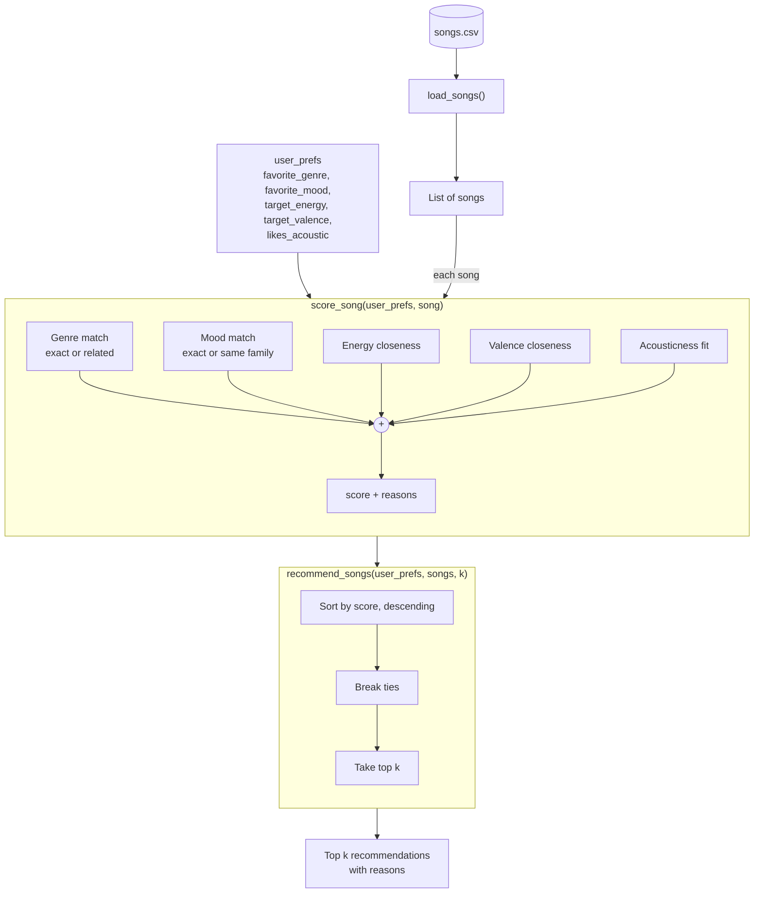

# 🎵 Music Recommender Simulation

## Project Summary

VibeMatch is a content-based music recommender that scores each of 20 songs
against a listener profile on genre, mood, energy, valence and acousticness,
for a maximum of 8.5 points. It returns the top 5 songs, and every
recommendation lists exactly where each of its points came from. On top of that
core, it adds opt-in stretch features: 5 advanced song attributes, 4 switchable
scoring modes, a diversity penalty for repeated artists and genres, and a
summary table view.

---

## How The System Works

### How real recommenders work

Platforms like Spotify and YouTube predict what you'll like next by combining
two approaches. **Collaborative filtering** learns from the behavior of many
users — plays, skips, saves, likes, playlist adds, watch time — and recommends
what people with similar habits enjoyed ("listeners like you also played…").
**Content-based filtering** describes each item by its own attributes — genre,
mood, tempo, energy, and audio features extracted from the sound itself — and
recommends items similar to what you already like. Real systems are hybrids:
collaborative filtering finds surprising connections, while content-based
filtering can recommend brand-new songs nobody has played yet (the "cold start"
problem).

Every recommender has three separate parts:

1. **Input data** – what the system knows about each song (its features).
2. **User preferences** – what the system knows about the listener (a taste
   profile, or at scale, their listening history).
3. **Ranking / selection** – how the system scores each song against the user
   and decides which ones to show, in what order.

### What my version does

My simulation is a **content-based** recommender. It has no other users to
learn from, so it compares each song's features directly against one user's
taste profile. It balances **how a song is labeled** (genre and mood, up to 4.5 points)
slightly above **how it sounds** (energy, valence, acousticness, up to 4.0
points). That way the numbers rank songs within a genre or mood, but a song
with no matching labels can't beat one that matches both. Energy and valence together capture a song's
"vibe": energy is how intense it feels, valence is how positive it feels.

### Features used

**`Song`**
- `genre` – category (pop, lofi, rock, …)
- `mood` – category (happy, chill, intense, …)
- `energy` – 0–1, how intense the song feels
- `valence` – 0–1, how positive/happy it sounds
- `acousticness` – 0–1, acoustic vs. electronic
- (`tempo_bpm` and `danceability` are kept in the data but not scored. In the
  original 10-song catalog, energy, tempo, acousticness and danceability moved
  almost together. In the expanded 20-song catalog, tempo still tracks energy
  closely (r≈0.84), acousticness runs opposite to it (r≈−0.61), and
  danceability is only loosely related (r≈0.42). I left tempo and danceability
  out to keep the model simple and avoid counting intensity twice.)

**`UserProfile`**
- `favorite_genre` – the genre they want
- `favorite_mood` – the mood they want
- `target_energy` – preferred energy level (0–1)
- `target_valence` – preferred positivity (0–1)
- `likes_acoustic` – True/False. If True, more acoustic songs earn more points; if False, more electronic (less acoustic) songs earn more points.

### Dataset

The catalog (`data/songs.csv`) started with 10 songs and was expanded to
**20 songs** to add missing genres (e.g., hip-hop, metal, folk, classical) and
moods (e.g., sad, angry, nostalgic), including low-valence songs the starter
data didn't have.

### Example user profile

```python
user_prefs = {
    "favorite_genre": "lofi",
    "favorite_mood": "chill",
    "target_energy": 0.40,
    "target_valence": 0.60,
    "likes_acoustic": True,
}
```

A calm, slightly positive, acoustic-leaning study listener.

### Algorithm Recipe

**Scoring Rule** (one song vs. one user, max 8.5 points):

| Feature | Points |
|---|---|
| Genre | +2.5 exact match · +1.25 related genre |
| Mood | +2.0 exact match · +1.0 same mood family |
| Energy | up to +2.0, based on closeness to the target |
| Valence | up to +1.5, based on closeness to the target |
| Acousticness | up to +0.5 → 0.5 × acousticness if `likes_acoustic`, else 0.5 × (1 − acousticness) |

Closeness uses a bell curve (Gaussian, σ = 0.20): a song near the user's target
gets nearly full points, and the score drops off quickly as the gap grows. This
rewards songs that are *close* to what the user wants, not simply higher or lower.

**Related genres** (partial credit): pop ↔ indie pop, rock ↔ metal,
lofi ↔ jazz, lofi ↔ ambient, electronic ↔ synthwave, folk ↔ country,
blues ↔ jazz, hip-hop ↔ r&b.

**Mood families** (partial credit): Calm (chill, relaxed, focused) ·
Bright (happy, carefree, hopeful) · Driven (energetic, intense, confident) ·
Low (sad, melancholy, moody) · Turbulent (angry, dramatic).

*Romantic* and *nostalgic* are intentionally left ungrouped: they're distinct
feelings, and grouping them would let someone who wants nostalgic folk get
romantic R&B.

**Why not the simpler +2 genre / +1 mood recipe?** In my data analysis, genre
labels were sparse (most genres have one song) and mood labels were inconsistent,
so I gave mood more weight and added valence and acousticness. That way the
system responds to how a song actually sounds, not just its tags.

**Ranking Rule** (all scored songs → final list):
1. Score every song in the catalog.
2. Sort from highest to lowest score.
3. Break ties by smallest energy distance, then by song id.
4. Return the top *k* songs (default 5), each with the reasons behind its score.

### Data flow



Example: for the profile above, *Library Rain* (lofi, chill, energy 0.35)
scores about **8.37 / 8.5**, while *Storm Runner* (rock, intense, energy 0.91)
scores about **1.38 / 8.5**.

### Expected biases

- **Genre imbalance:** lofi has the most songs *and* two related genres (jazz,
  ambient), so lofi listeners get many more good matches than others.
- **Unequal partial credit:** classical, reggae, and latin have no related
  genres, so fans of those get either one exact match or nothing.
- **Narrow profile:** a single `favorite_genre` means most songs earn 0 genre
  points. A user who likes two genres can't express that.
- **Double counting:** mood families and valence partly measure the same thing
  (a "sad" match plus low valence), so emotionally labeled songs get rewarded twice.
- **Conflicting preferences:** a user who wants "rock" but also "chill, low
  energy" may get no rock songs at all, because mood + energy outweigh genre.
- **Filter bubble:** nothing stops the top 5 from being all one genre or one
  artist. This is addressed by the opt-in `--diverse` flag (see Stretch
  Features).

---

## Getting Started

### Setup

1. Create a virtual environment (optional but recommended):

   ```bash
   python -m venv .venv
   source .venv/bin/activate      # Mac or Linux
   .venv\Scripts\activate         # Windows
   ```

2. Install dependencies

```bash
pip install -r requirements.txt
```

3. Run the app:

```bash
python -m src.main
```

### Running Tests

Run the starter tests with:

```bash
pytest
```

You can add more tests in `tests/test_recommender.py`.

---

## Sample Recommendation Output

```text
Loaded songs: 20

######################################################
PROFILE: High-Energy Pop
genre=pop | mood=happy | energy=0.80 | valence=0.80 | acoustic=no
mode=balanced
######################################################

Top 5 recommendations
======================================================
1. Sunrise City - Neon Echo                    Score: 8.37 / 8.5
     + genre match: pop (+2.50)
     + mood match: happy (+2.00)
     + energy 0.82 vs target 0.80 (+1.99)
     + valence 0.84 vs target 0.80 (+1.47)
     + acousticness 0.18, prefers non-acoustic (+0.41)
------------------------------------------------------
2. Rooftop Lights - Indigo Parade              Score: 7.04 / 8.5
     + related genre: indie pop ~ pop (+1.25)
     + mood match: happy (+2.00)
     + energy 0.76 vs target 0.80 (+1.96)
     + valence 0.81 vs target 0.80 (+1.50)
     + acousticness 0.35, prefers non-acoustic (+0.33)
------------------------------------------------------
3. Gym Hero - Max Pulse                        Score: 6.07 / 8.5
     + genre match: pop (+2.50)
     + no mood match: intense (+0.00)
     + energy 0.93 vs target 0.80 (+1.62)
     + valence 0.77 vs target 0.80 (+1.48)
     + acousticness 0.05, prefers non-acoustic (+0.47)
------------------------------------------------------
4. Island Slowdown - Roots Harbor              Score: 3.67 / 8.5
     + no genre match: reggae (+0.00)
     + mood family match: carefree ~ happy (+1.00)
     + energy 0.55 vs target 0.80 (+0.92)
     + valence 0.85 vs target 0.80 (+1.45)
     + acousticness 0.40, prefers non-acoustic (+0.30)
------------------------------------------------------
5. Fuego en la Plaza - Los Faroles             Score: 3.57 / 8.5
     + no genre match: latin (+0.00)
     + no mood match: energetic (+0.00)
     + energy 0.86 vs target 0.80 (+1.91)
     + valence 0.88 vs target 0.80 (+1.38)
     + acousticness 0.45, prefers non-acoustic (+0.28)
```

  - Sunrise City ranks first because it matches every preference. Rooftop Lights is
  second thanks to partial genre credit (indie pop ~ pop), and Gym Hero is still in
  the top 3 because its genre and energy match, even though its mood ("intense")
  doesn't.
---

## Experiments You Tried

### Profile results

I ran the recommender (`python -m src.main`) for 3 standard, 4 edge-case
(designed to trick the scoring logic), and 1 advanced profile (the advanced one
is shown under Stretch Features). Full top-5 output for the first 7:

#### 1. High-Energy Pop
```
######################################################
PROFILE: High-Energy Pop
genre=pop | mood=happy | energy=0.80 | valence=0.80 | acoustic=no
mode=balanced
######################################################

Top 5 recommendations
======================================================
1. Sunrise City - Neon Echo                    Score: 8.37 / 8.5
     + genre match: pop (+2.50)
     + mood match: happy (+2.00)
     + energy 0.82 vs target 0.80 (+1.99)
     + valence 0.84 vs target 0.80 (+1.47)
     + acousticness 0.18, prefers non-acoustic (+0.41)
------------------------------------------------------
2. Rooftop Lights - Indigo Parade              Score: 7.04 / 8.5
     + related genre: indie pop ~ pop (+1.25)
     + mood match: happy (+2.00)
     + energy 0.76 vs target 0.80 (+1.96)
     + valence 0.81 vs target 0.80 (+1.50)
     + acousticness 0.35, prefers non-acoustic (+0.33)
------------------------------------------------------
3. Gym Hero - Max Pulse                        Score: 6.07 / 8.5
     + genre match: pop (+2.50)
     + no mood match: intense (+0.00)
     + energy 0.93 vs target 0.80 (+1.62)
     + valence 0.77 vs target 0.80 (+1.48)
     + acousticness 0.05, prefers non-acoustic (+0.47)
------------------------------------------------------
4. Island Slowdown - Roots Harbor              Score: 3.67 / 8.5
     + no genre match: reggae (+0.00)
     + mood family match: carefree ~ happy (+1.00)
     + energy 0.55 vs target 0.80 (+0.92)
     + valence 0.85 vs target 0.80 (+1.45)
     + acousticness 0.40, prefers non-acoustic (+0.30)
------------------------------------------------------
5. Fuego en la Plaza - Los Faroles             Score: 3.57 / 8.5
     + no genre match: latin (+0.00)
     + no mood match: energetic (+0.00)
     + energy 0.86 vs target 0.80 (+1.91)
     + valence 0.88 vs target 0.80 (+1.38)
     + acousticness 0.45, prefers non-acoustic (+0.28)
```

#### 2. Chill Lofi
```
######################################################
PROFILE: Chill Lofi
genre=lofi | mood=chill | energy=0.40 | valence=0.60 | acoustic=yes
mode=balanced
######################################################

Top 5 recommendations
======================================================
1. Library Rain - Paper Lanterns               Score: 8.37 / 8.5
     + genre match: lofi (+2.50)
     + mood match: chill (+2.00)
     + energy 0.35 vs target 0.40 (+1.94)
     + valence 0.60 vs target 0.60 (+1.50)
     + acousticness 0.86, likes acoustic (+0.43)
------------------------------------------------------
2. Midnight Coding - LoRoom                    Score: 8.31 / 8.5
     + genre match: lofi (+2.50)
     + mood match: chill (+2.00)
     + energy 0.42 vs target 0.40 (+1.99)
     + valence 0.56 vs target 0.60 (+1.47)
     + acousticness 0.71, likes acoustic (+0.35)
------------------------------------------------------
3. Focus Flow - LoRoom                         Score: 7.39 / 8.5
     + genre match: lofi (+2.50)
     + mood family match: focused ~ chill (+1.00)
     + energy 0.40 vs target 0.40 (+2.00)
     + valence 0.59 vs target 0.60 (+1.50)
     + acousticness 0.78, likes acoustic (+0.39)
------------------------------------------------------
4. Spacewalk Thoughts - Orbit Bloom            Score: 6.83 / 8.5
     + related genre: ambient ~ lofi (+1.25)
     + mood match: chill (+2.00)
     + energy 0.28 vs target 0.40 (+1.67)
     + valence 0.65 vs target 0.60 (+1.45)
     + acousticness 0.92, likes acoustic (+0.46)
------------------------------------------------------
5. Coffee Shop Stories - Slow Stereo           Score: 5.97 / 8.5
     + related genre: jazz ~ lofi (+1.25)
     + mood family match: relaxed ~ chill (+1.00)
     + energy 0.37 vs target 0.40 (+1.98)
     + valence 0.71 vs target 0.60 (+1.29)
     + acousticness 0.89, likes acoustic (+0.45)
```

#### 3. Deep Intense Rock
```
######################################################
PROFILE: Deep Intense Rock
genre=rock | mood=intense | energy=0.90 | valence=0.40 | acoustic=no
mode=balanced
######################################################

Top 5 recommendations
======================================================
1. Storm Runner - Voltline                     Score: 8.33 / 8.5
     + genre match: rock (+2.50)
     + mood match: intense (+2.00)
     + energy 0.91 vs target 0.90 (+2.00)
     + valence 0.48 vs target 0.40 (+1.38)
     + acousticness 0.10, prefers non-acoustic (+0.45)
------------------------------------------------------
2. Gym Hero - Max Pulse                        Score: 4.72 / 8.5
     + no genre match: pop (+0.00)
     + mood match: intense (+2.00)
     + energy 0.93 vs target 0.90 (+1.98)
     + valence 0.77 vs target 0.40 (+0.27)
     + acousticness 0.05, prefers non-acoustic (+0.47)
------------------------------------------------------
3. Ironclad Fury - Grave Circuit               Score: 4.43 / 8.5
     + related genre: metal ~ rock (+1.25)
     + no mood match: angry (+0.00)
     + energy 0.97 vs target 0.90 (+1.88)
     + valence 0.18 vs target 0.40 (+0.82)
     + acousticness 0.03, prefers non-acoustic (+0.48)
------------------------------------------------------
4. Concrete Psalms - Verse Theory              Score: 4.02 / 8.5
     + no genre match: hip-hop (+0.00)
     + mood family match: confident ~ intense (+1.00)
     + energy 0.80 vs target 0.90 (+1.76)
     + valence 0.62 vs target 0.40 (+0.82)
     + acousticness 0.12, prefers non-acoustic (+0.44)
------------------------------------------------------
5. Fuego en la Plaza - Los Faroles             Score: 3.32 / 8.5
     + no genre match: latin (+0.00)
     + mood family match: energetic ~ intense (+1.00)
     + energy 0.86 vs target 0.90 (+1.96)
     + valence 0.88 vs target 0.40 (+0.08)
     + acousticness 0.45, prefers non-acoustic (+0.28)
```

#### 4. Sad Banger (edge case)
```
######################################################
PROFILE: Sad Banger (edge case)
genre=blues | mood=sad | energy=0.90 | valence=0.20 | acoustic=no
mode=balanced
######################################################

Top 5 recommendations
======================================================
1. Rust in the Rain - Delta Marrow             Score: 6.13 / 8.5
     + genre match: blues (+2.50)
     + mood match: sad (+2.00)
     + energy 0.33 vs target 0.90 (+0.03)
     + valence 0.22 vs target 0.20 (+1.49)
     + acousticness 0.78, prefers non-acoustic (+0.11)
------------------------------------------------------
2. Ironclad Fury - Grave Circuit               Score: 3.85 / 8.5
     + no genre match: metal (+0.00)
     + no mood match: angry (+0.00)
     + energy 0.97 vs target 0.90 (+1.88)
     + valence 0.18 vs target 0.20 (+1.49)
     + acousticness 0.03, prefers non-acoustic (+0.48)
------------------------------------------------------
3. Night Drive Loop - Neon Echo                Score: 3.42 / 8.5
     + no genre match: synthwave (+0.00)
     + mood family match: moody ~ sad (+1.00)
     + energy 0.75 vs target 0.90 (+1.51)
     + valence 0.49 vs target 0.20 (+0.52)
     + acousticness 0.22, prefers non-acoustic (+0.39)
------------------------------------------------------
4. Storm Runner - Voltline                     Score: 3.01 / 8.5
     + no genre match: rock (+0.00)
     + no mood match: intense (+0.00)
     + energy 0.91 vs target 0.90 (+2.00)
     + valence 0.48 vs target 0.20 (+0.56)
     + acousticness 0.10, prefers non-acoustic (+0.45)
------------------------------------------------------
5. Afterglow Static - Kaito Mere               Score: 2.86 / 8.5
     + no genre match: electronic (+0.00)
     + mood family match: melancholy ~ sad (+1.00)
     + energy 0.30 vs target 0.90 (+0.02)
     + valence 0.28 vs target 0.20 (+1.38)
     + acousticness 0.08, prefers non-acoustic (+0.46)
```

#### 5. Acoustic Chill Rock (edge case)
```
######################################################
PROFILE: Acoustic Chill Rock (edge case)
genre=rock | mood=chill | energy=0.20 | valence=0.60 | acoustic=yes
mode=balanced
######################################################

Top 5 recommendations
======================================================
1. Spacewalk Thoughts - Orbit Bloom            Score: 5.76 / 8.5
     + no genre match: ambient (+0.00)
     + mood match: chill (+2.00)
     + energy 0.28 vs target 0.20 (+1.85)
     + valence 0.65 vs target 0.60 (+1.45)
     + acousticness 0.92, likes acoustic (+0.46)
------------------------------------------------------
2. Library Rain - Paper Lanterns               Score: 5.44 / 8.5
     + no genre match: lofi (+0.00)
     + mood match: chill (+2.00)
     + energy 0.35 vs target 0.20 (+1.51)
     + valence 0.60 vs target 0.60 (+1.50)
     + acousticness 0.86, likes acoustic (+0.43)
------------------------------------------------------
3. Midnight Coding - LoRoom                    Score: 4.91 / 8.5
     + no genre match: lofi (+0.00)
     + mood match: chill (+2.00)
     + energy 0.42 vs target 0.20 (+1.09)
     + valence 0.56 vs target 0.60 (+1.47)
     + acousticness 0.71, likes acoustic (+0.35)
------------------------------------------------------
4. Coffee Shop Stories - Slow Stereo           Score: 4.13 / 8.5
     + no genre match: jazz (+0.00)
     + mood family match: relaxed ~ chill (+1.00)
     + energy 0.37 vs target 0.20 (+1.39)
     + valence 0.71 vs target 0.60 (+1.29)
     + acousticness 0.89, likes acoustic (+0.45)
------------------------------------------------------
5. Focus Flow - LoRoom                         Score: 4.10 / 8.5
     + no genre match: lofi (+0.00)
     + mood family match: focused ~ chill (+1.00)
     + energy 0.40 vs target 0.20 (+1.21)
     + valence 0.59 vs target 0.60 (+1.50)
     + acousticness 0.78, likes acoustic (+0.39)
```

#### 6. Ghost Genre (edge case)
```
######################################################
PROFILE: Ghost Genre (edge case)
genre=k-pop | mood=happy | energy=0.80 | valence=0.80 | acoustic=no
mode=balanced
######################################################

Top 5 recommendations
======================================================
1. Sunrise City - Neon Echo                    Score: 5.87 / 8.5
     + no genre match: pop (+0.00)
     + mood match: happy (+2.00)
     + energy 0.82 vs target 0.80 (+1.99)
     + valence 0.84 vs target 0.80 (+1.47)
     + acousticness 0.18, prefers non-acoustic (+0.41)
------------------------------------------------------
2. Rooftop Lights - Indigo Parade              Score: 5.79 / 8.5
     + no genre match: indie pop (+0.00)
     + mood match: happy (+2.00)
     + energy 0.76 vs target 0.80 (+1.96)
     + valence 0.81 vs target 0.80 (+1.50)
     + acousticness 0.35, prefers non-acoustic (+0.33)
------------------------------------------------------
3. Island Slowdown - Roots Harbor              Score: 3.67 / 8.5
     + no genre match: reggae (+0.00)
     + mood family match: carefree ~ happy (+1.00)
     + energy 0.55 vs target 0.80 (+0.92)
     + valence 0.85 vs target 0.80 (+1.45)
     + acousticness 0.40, prefers non-acoustic (+0.30)
------------------------------------------------------
4. Fuego en la Plaza - Los Faroles             Score: 3.57 / 8.5
     + no genre match: latin (+0.00)
     + no mood match: energetic (+0.00)
     + energy 0.86 vs target 0.80 (+1.91)
     + valence 0.88 vs target 0.80 (+1.38)
     + acousticness 0.45, prefers non-acoustic (+0.28)
------------------------------------------------------
5. Gym Hero - Max Pulse                        Score: 3.57 / 8.5
     + no genre match: pop (+0.00)
     + no mood match: intense (+0.00)
     + energy 0.93 vs target 0.80 (+1.62)
     + valence 0.77 vs target 0.80 (+1.48)
     + acousticness 0.05, prefers non-acoustic (+0.47)
```

#### 7. Silent Classical (edge case)
```
######################################################
PROFILE: Silent Classical (edge case)
genre=classical | mood=calm | energy=0.00 | valence=1.00 | acoustic=yes
mode=balanced
######################################################

Top 5 recommendations
======================================================
1. Tempest Overture - Varga Chamber Ensemble   Score: 2.97 / 8.5
     + genre match: classical (+2.50)
     + no mood match: dramatic (+0.00)
     + energy 0.72 vs target 0.00 (+0.00)
     + valence 0.30 vs target 1.00 (+0.00)
     + acousticness 0.95, likes acoustic (+0.47)
------------------------------------------------------
2. Spacewalk Thoughts - Orbit Bloom            Score: 1.53 / 8.5
     + no genre match: ambient (+0.00)
     + no mood match: chill (+0.00)
     + energy 0.28 vs target 0.00 (+0.75)
     + valence 0.65 vs target 1.00 (+0.32)
     + acousticness 0.92, likes acoustic (+0.46)
------------------------------------------------------
3. Fuego en la Plaza - Los Faroles             Score: 1.48 / 8.5
     + no genre match: latin (+0.00)
     + no mood match: energetic (+0.00)
     + energy 0.86 vs target 0.00 (+0.00)
     + valence 0.88 vs target 1.00 (+1.25)
     + acousticness 0.45, likes acoustic (+0.23)
------------------------------------------------------
4. Island Slowdown - Roots Harbor              Score: 1.38 / 8.5
     + no genre match: reggae (+0.00)
     + no mood match: carefree (+0.00)
     + energy 0.55 vs target 0.00 (+0.05)
     + valence 0.85 vs target 1.00 (+1.13)
     + acousticness 0.40, likes acoustic (+0.20)
------------------------------------------------------
5. Coffee Shop Stories - Slow Stereo           Score: 1.33 / 8.5
     + no genre match: jazz (+0.00)
     + no mood match: relaxed (+0.00)
     + energy 0.37 vs target 0.00 (+0.36)
     + valence 0.71 vs target 1.00 (+0.52)
     + acousticness 0.89, likes acoustic (+0.45)
```

### Experiment: Weight Shift (energy x2, genre x0.5)

**Change:** energy weight 2.0 → 4.0, genre weight 2.5 → 1.25 (related genre
1.25 → 0.625). Max score went from 8.5 to 9.25. Everything else unchanged.

**Hypothesis:** I expected songs that *sound* right (energy close to the
target) to beat songs that are only *labeled* right, so Sad Banger would finally
get a high-energy song at #1 while the standard profiles kept their #1.

| Profile | #1 before | #1 after | Top 5 changes |
|---|---|---|---|
| High-Energy Pop | Sunrise City (8.37) | Sunrise City (9.11) | Top 3 unchanged. Island Slowdown (#4, 3.67) dropped out; Fuego en la Plaza moved #5 → #4 (5.48); Concrete Psalms entered at #5 (5.44). |
| Chill Lofi | Library Rain (8.37) | Library Rain (9.06) | No change: same 5 songs in the same order. |
| Deep Intense Rock | Storm Runner (8.33) | Storm Runner (9.08) | Concrete Psalms #4 → #3 (5.79) and Ironclad Fury #3 → #4 (5.68) swapped; Gym Hero (#2) and Fuego en la Plaza (#5) stayed. |
| Sad Banger (edge case) | Rust in the Rain (6.13) | Ironclad Fury (5.73) | Rust in the Rain fell #1 → #4 (4.92); Storm Runner rose #4 → #2 (5.01); Night Drive Loop stayed #3 (4.93); Afterglow Static dropped out; Gym Hero entered at #5 (4.46). |
| Acoustic Chill Rock (edge case) | Spacewalk Thoughts (5.76) | Spacewalk Thoughts (7.60) | No change: same 5 songs in the same order (still no rock song). |
| Ghost Genre (edge case) | Sunrise City (5.87) | Sunrise City (7.86) | Island Slowdown (#3) dropped out; Fuego en la Plaza #4 → #3 (5.48); Concrete Psalms entered at #4 (5.44); Gym Hero stayed #5 (5.19). |
| Silent Classical (edge case) | Tempest Overture (2.97) | Spacewalk Thoughts (2.28) | Tempest Overture fell #1 → #2 (1.73); Coffee Shop Stories #5 → #3 (1.69); Library Rain entered at #4 (1.50); Fuego en la Plaza #3 → #5 (1.48); Island Slowdown dropped out. |

AFTER output (experimental weights) for the two most affected profiles:

```
######################################################
PROFILE: Sad Banger (edge case)
genre=blues | mood=sad | energy=0.90 | valence=0.20 | acoustic=no
######################################################

Top 5 recommendations
======================================================
1. Ironclad Fury - Grave Circuit               Score: 5.73 / 9.25
     + no genre match: metal (+0.00)
     + no mood match: angry (+0.00)
     + energy 0.97 vs target 0.90 (+3.76)
     + valence 0.18 vs target 0.20 (+1.49)
     + acousticness 0.03, prefers non-acoustic (+0.48)
------------------------------------------------------
2. Storm Runner - Voltline                     Score: 5.01 / 9.25
     + no genre match: rock (+0.00)
     + no mood match: intense (+0.00)
     + energy 0.91 vs target 0.90 (+4.00)
     + valence 0.48 vs target 0.20 (+0.56)
     + acousticness 0.10, prefers non-acoustic (+0.45)
------------------------------------------------------
3. Night Drive Loop - Neon Echo                Score: 4.93 / 9.25
     + no genre match: synthwave (+0.00)
     + mood family match: moody ~ sad (+1.00)
     + energy 0.75 vs target 0.90 (+3.02)
     + valence 0.49 vs target 0.20 (+0.52)
     + acousticness 0.22, prefers non-acoustic (+0.39)
------------------------------------------------------
4. Rust in the Rain - Delta Marrow             Score: 4.92 / 9.25
     + genre match: blues (+1.25)
     + mood match: sad (+2.00)
     + energy 0.33 vs target 0.90 (+0.07)
     + valence 0.22 vs target 0.20 (+1.49)
     + acousticness 0.78, prefers non-acoustic (+0.11)
------------------------------------------------------
5. Gym Hero - Max Pulse                        Score: 4.46 / 9.25
     + no genre match: pop (+0.00)
     + no mood match: intense (+0.00)
     + energy 0.93 vs target 0.90 (+3.96)
     + valence 0.77 vs target 0.20 (+0.03)
     + acousticness 0.05, prefers non-acoustic (+0.47)

######################################################
PROFILE: High-Energy Pop
genre=pop | mood=happy | energy=0.80 | valence=0.80 | acoustic=no
######################################################

Top 5 recommendations
======================================================
1. Sunrise City - Neon Echo                    Score: 9.11 / 9.25
     + genre match: pop (+1.25)
     + mood match: happy (+2.00)
     + energy 0.82 vs target 0.80 (+3.98)
     + valence 0.84 vs target 0.80 (+1.47)
     + acousticness 0.18, prefers non-acoustic (+0.41)
------------------------------------------------------
2. Rooftop Lights - Indigo Parade              Score: 8.37 / 9.25
     + related genre: indie pop ~ pop (+0.62)
     + mood match: happy (+2.00)
     + energy 0.76 vs target 0.80 (+3.92)
     + valence 0.81 vs target 0.80 (+1.50)
     + acousticness 0.35, prefers non-acoustic (+0.33)
------------------------------------------------------
3. Gym Hero - Max Pulse                        Score: 6.44 / 9.25
     + genre match: pop (+1.25)
     + no mood match: intense (+0.00)
     + energy 0.93 vs target 0.80 (+3.24)
     + valence 0.77 vs target 0.80 (+1.48)
     + acousticness 0.05, prefers non-acoustic (+0.47)
------------------------------------------------------
4. Fuego en la Plaza - Los Faroles             Score: 5.48 / 9.25
     + no genre match: latin (+0.00)
     + no mood match: energetic (+0.00)
     + energy 0.86 vs target 0.80 (+3.82)
     + valence 0.88 vs target 0.80 (+1.38)
     + acousticness 0.45, prefers non-acoustic (+0.28)
------------------------------------------------------
5. Concrete Psalms - Verse Theory              Score: 5.44 / 9.25
     + no genre match: hip-hop (+0.00)
     + no mood match: confident (+0.00)
     + energy 0.80 vs target 0.80 (+4.00)
     + valence 0.62 vs target 0.80 (+1.00)
     + acousticness 0.12, prefers non-acoustic (+0.44)
```

*(The related-genre reason shows +0.62 because 0.625 is rounded to 2 decimals
for display.)*

**More accurate or just different?** Some profiles got more accurate: Sad
Banger now opens with a loud, dark song (Ironclad Fury), and High-Energy Pop
swapped out the slow Island Slowdown for upbeat Fuego en la Plaza, which is the
swap I wanted in Step 2. Others just got different or worse: the one classical
song lost #1 in Silent Classical, the metal song (related to rock) slipped
below a hip-hop song in Deep Intense Rock, and Sad Banger's #2 and #5 (Storm
Runner, Gym Hero) match no labels at all, so they're there only because their
energy is close. Energy is now worth 4 of 9.25 points, so the system went from
"labels decide" to "energy decides". A better balance is probably somewhere
between the original weights and these.


---

## Limitations and Risks

- **Tiny catalog:** only 20 songs, and most genres have just 1 song.
- **Labels and sound are weighted almost equally** (4.5 vs. 4.0 points), so one
  group can override the other. A blues/sad fan who wants loud music gets a
  quiet song at #1, and a rock fan who wants chill music gets no rock at all.
- **Unknown genres and moods fail silently:** "k-pop" or "calm" just match
  nothing, with no warning to the user.

See the [Model Card](model_card.md) for full details.

---

## Stretch Features

Every stretch feature is opt-in. Running `python -m src.main` with no flags
gives the same scores and rankings as before for the 7 original profiles; the
only additions are a `mode=balanced` line in each header and the new
"Nostalgic Explorer (advanced)" profile at the end. Flags can be combined, for
example `python -m src.main --table --mode mood-first --diverse`.

### 1. Advanced song features

`data/songs.csv` has 5 new columns for every song: `popularity` (0-100),
`release_decade` (e.g. 1970), `mood_tags` (semicolon-separated, e.g.
`nostalgic;wistful;warm`), `instrumentalness` (0-1) and `lyrics_language`
(english, spanish or instrumental). A profile can use 5 new optional keys:

| Key | How it scores | Max points |
|---|---|---|
| `target_popularity` | closeness (same bell curve as energy), popularity scaled to 0-1 | 0.5 |
| `preferred_decade` | full points for the same decade, half for +/-10 years | 0.75 |
| `mood_tags` | 0.35 per shared tag, capped | 1.0 |
| `target_instrumentalness` | closeness (bell curve) | 0.75 |
| `preferred_language` | exact match | 0.5 |

If a profile doesn't use a key, that feature adds no points, no reason line,
and doesn't count toward the max score. That's why the original profiles are
still scored out of 8.5 while "Nostalgic Explorer (advanced)", which uses all
5 keys, is scored out of 12.

Run: `python -m src.main` (the advanced profile is printed last)

```text
######################################################
PROFILE: Nostalgic Explorer (advanced)
genre=folk | mood=nostalgic | energy=0.55 | valence=0.55 | acoustic=yes
target_popularity=40 | preferred_decade=1970 | mood_tags=nostalgic;warm;wistful | target_instrumentalness=0.15 | preferred_language=english
mode=balanced
######################################################

Top 5 recommendations
======================================================
1. Hollow Porch Light - Wren & Willow          Score: 11.54 / 12
     + genre match: folk (+2.50)
     + mood match: nostalgic (+2.00)
     + energy 0.68 vs target 0.55 (+1.62)
     + valence 0.58 vs target 0.55 (+1.48)
     + acousticness 0.93, likes acoustic (+0.47)
     + popularity 34 vs target 40 (+0.48)
     + decade match: 1970s (+0.75)
     + mood tags: nostalgic, wistful, warm (+1.00)
     + instrumentalness 0.12 vs target 0.15 (+0.74)
     + language match: english (+0.50)
------------------------------------------------------
2. Dust Road Letters - June Harlan             Score: 7.06 / 12
     + related genre: country ~ folk (+1.25)
     + no mood match: hopeful (+0.00)
     + energy 0.58 vs target 0.55 (+1.98)
     + valence 0.70 vs target 0.55 (+1.13)
     + acousticness 0.74, likes acoustic (+0.37)
     + popularity 52 vs target 40 (+0.42)
     + near decade: 1980s ~ 1970s (+0.38)
     + mood tags: nostalgic (+0.35)
     + instrumentalness 0.06 vs target 0.15 (+0.68)
     + language match: english (+0.50)
------------------------------------------------------
3. Velvet Hours - Sienna Cole                  Score: 5.06 / 12
     + no genre match: r&b (+0.00)
     + no mood match: romantic (+0.00)
     + energy 0.52 vs target 0.55 (+1.98)
     + valence 0.66 vs target 0.55 (+1.29)
     + acousticness 0.32, likes acoustic (+0.16)
     + popularity 71 vs target 40 (+0.15)
     + no decade match: 1990s (+0.00)
     + mood tags: warm (+0.35)
     + instrumentalness 0.03 vs target 0.15 (+0.63)
     + language match: english (+0.50)
------------------------------------------------------
4. Island Slowdown - Roots Harbor              Score: 4.89 / 12
     + no genre match: reggae (+0.00)
     + no mood match: carefree (+0.00)
     + energy 0.55 vs target 0.55 (+2.00)
     + valence 0.85 vs target 0.55 (+0.49)
     + acousticness 0.40, likes acoustic (+0.20)
     + popularity 55 vs target 40 (+0.38)
     + decade match: 1970s (+0.75)
     + no mood tag overlap (+0.00)
     + instrumentalness 0.30 vs target 0.15 (+0.57)
     + language match: english (+0.50)
------------------------------------------------------
5. Night Drive Loop - Neon Echo                Score: 4.55 / 12
     + no genre match: synthwave (+0.00)
     + no mood match: moody (+0.00)
     + energy 0.75 vs target 0.55 (+1.21)
     + valence 0.49 vs target 0.55 (+1.43)
     + acousticness 0.22, likes acoustic (+0.11)
     + popularity 58 vs target 40 (+0.33)
     + near decade: 1980s ~ 1970s (+0.38)
     + mood tags: nostalgic (+0.35)
     + instrumentalness 0.45 vs target 0.15 (+0.24)
     + language match: english (+0.50)
```

### 2. Scoring modes (Strategy pattern)

`--mode` picks a ranking strategy: `balanced` (default, the original
weights), `genre-first`, `mood-first` or `energy-focused`. Each mode is just a
different set of weights (a `ScoringWeights` object in `SCORING_MODES`), and
`score_song` is the only place that scores. All modes keep the same 8.5-point
ceiling so scores stay comparable.

| Mode | Genre (exact / related) | Mood (exact / family) | Energy | Valence | Acoustic |
|---|---|---|---|---|---|
| balanced | 2.5 / 1.25 | 2.0 / 1.0 | 2.0 | 1.5 | 0.5 |
| genre-first | 4.0 / 2.0 | 1.5 / 0.75 | 1.5 | 1.0 | 0.5 |
| mood-first | 1.5 / 0.75 | 3.5 / 1.75 | 1.5 | 1.5 | 0.5 |
| energy-focused | 1.5 / 0.75 | 1.5 / 0.75 | 4.0 | 1.0 | 0.5 |

Run: `python -m src.main --mode mood-first`

**Balanced (default):**

```text
######################################################
PROFILE: Sad Banger (edge case)
genre=blues | mood=sad | energy=0.90 | valence=0.20 | acoustic=no
mode=balanced
######################################################

Top 5 recommendations
======================================================
1. Rust in the Rain - Delta Marrow             Score: 6.13 / 8.5
     + genre match: blues (+2.50)
     + mood match: sad (+2.00)
     + energy 0.33 vs target 0.90 (+0.03)
     + valence 0.22 vs target 0.20 (+1.49)
     + acousticness 0.78, prefers non-acoustic (+0.11)
------------------------------------------------------
2. Ironclad Fury - Grave Circuit               Score: 3.85 / 8.5
     + no genre match: metal (+0.00)
     + no mood match: angry (+0.00)
     + energy 0.97 vs target 0.90 (+1.88)
     + valence 0.18 vs target 0.20 (+1.49)
     + acousticness 0.03, prefers non-acoustic (+0.48)
------------------------------------------------------
3. Night Drive Loop - Neon Echo                Score: 3.42 / 8.5
     + no genre match: synthwave (+0.00)
     + mood family match: moody ~ sad (+1.00)
     + energy 0.75 vs target 0.90 (+1.51)
     + valence 0.49 vs target 0.20 (+0.52)
     + acousticness 0.22, prefers non-acoustic (+0.39)
------------------------------------------------------
4. Storm Runner - Voltline                     Score: 3.01 / 8.5
     + no genre match: rock (+0.00)
     + no mood match: intense (+0.00)
     + energy 0.91 vs target 0.90 (+2.00)
     + valence 0.48 vs target 0.20 (+0.56)
     + acousticness 0.10, prefers non-acoustic (+0.45)
------------------------------------------------------
5. Afterglow Static - Kaito Mere               Score: 2.86 / 8.5
     + no genre match: electronic (+0.00)
     + mood family match: melancholy ~ sad (+1.00)
     + energy 0.30 vs target 0.90 (+0.02)
     + valence 0.28 vs target 0.20 (+1.38)
     + acousticness 0.08, prefers non-acoustic (+0.46)
```

**Mood-first:**

```text
######################################################
PROFILE: Sad Banger (edge case)
genre=blues | mood=sad | energy=0.90 | valence=0.20 | acoustic=no
mode=mood-first
######################################################

Top 5 recommendations
======================================================
1. Rust in the Rain - Delta Marrow             Score: 6.63 / 8.5
     + genre match: blues (+1.50)
     + mood match: sad (+3.50)
     + energy 0.33 vs target 0.90 (+0.03)
     + valence 0.22 vs target 0.20 (+1.49)
     + acousticness 0.78, prefers non-acoustic (+0.11)
------------------------------------------------------
2. Night Drive Loop - Neon Echo                Score: 3.79 / 8.5
     + no genre match: synthwave (+0.00)
     + mood family match: moody ~ sad (+1.75)
     + energy 0.75 vs target 0.90 (+1.13)
     + valence 0.49 vs target 0.20 (+0.52)
     + acousticness 0.22, prefers non-acoustic (+0.39)
------------------------------------------------------
3. Afterglow Static - Kaito Mere               Score: 3.61 / 8.5
     + no genre match: electronic (+0.00)
     + mood family match: melancholy ~ sad (+1.75)
     + energy 0.30 vs target 0.90 (+0.02)
     + valence 0.28 vs target 0.20 (+1.38)
     + acousticness 0.08, prefers non-acoustic (+0.46)
------------------------------------------------------
4. Ironclad Fury - Grave Circuit               Score: 3.38 / 8.5
     + no genre match: metal (+0.00)
     + no mood match: angry (+0.00)
     + energy 0.97 vs target 0.90 (+1.41)
     + valence 0.18 vs target 0.20 (+1.49)
     + acousticness 0.03, prefers non-acoustic (+0.48)
------------------------------------------------------
5. Storm Runner - Voltline                     Score: 2.51 / 8.5
     + no genre match: rock (+0.00)
     + no mood match: intense (+0.00)
     + energy 0.91 vs target 0.90 (+1.50)
     + valence 0.48 vs target 0.20 (+0.56)
     + acousticness 0.10, prefers non-acoustic (+0.45)
```

**What changed:** with mood worth 3.5 points, the two "low"-mood songs (Night
Drive Loop is moody, Afterglow Static is melancholy) move up to #2 and #3,
and the angry, loud Ironclad Fury falls from #2 to #4 (3.85 to 3.38). Rust in
the Rain stays #1 and gains a bigger lead (6.13 to 6.63), so this mode
doubles down on "sad" over "loud".

### 3. Diversity penalty

`--diverse` re-ranks the list greedily in `recommend_songs`: it picks songs one
at a time, and each remaining song loses 1.50 points if its artist is already
in the list and 0.75 if its genre already appears 2 or more times. The penalty
shows up as its own reason line, so the reasons still add up to the score.

Run: `python -m src.main --diverse`

**Without `--diverse`:**

```text
######################################################
PROFILE: Chill Lofi
genre=lofi | mood=chill | energy=0.40 | valence=0.60 | acoustic=yes
mode=balanced
######################################################

Top 5 recommendations
======================================================
1. Library Rain - Paper Lanterns               Score: 8.37 / 8.5
     + genre match: lofi (+2.50)
     + mood match: chill (+2.00)
     + energy 0.35 vs target 0.40 (+1.94)
     + valence 0.60 vs target 0.60 (+1.50)
     + acousticness 0.86, likes acoustic (+0.43)
------------------------------------------------------
2. Midnight Coding - LoRoom                    Score: 8.31 / 8.5
     + genre match: lofi (+2.50)
     + mood match: chill (+2.00)
     + energy 0.42 vs target 0.40 (+1.99)
     + valence 0.56 vs target 0.60 (+1.47)
     + acousticness 0.71, likes acoustic (+0.35)
------------------------------------------------------
3. Focus Flow - LoRoom                         Score: 7.39 / 8.5
     + genre match: lofi (+2.50)
     + mood family match: focused ~ chill (+1.00)
     + energy 0.40 vs target 0.40 (+2.00)
     + valence 0.59 vs target 0.60 (+1.50)
     + acousticness 0.78, likes acoustic (+0.39)
------------------------------------------------------
4. Spacewalk Thoughts - Orbit Bloom            Score: 6.83 / 8.5
     + related genre: ambient ~ lofi (+1.25)
     + mood match: chill (+2.00)
     + energy 0.28 vs target 0.40 (+1.67)
     + valence 0.65 vs target 0.60 (+1.45)
     + acousticness 0.92, likes acoustic (+0.46)
------------------------------------------------------
5. Coffee Shop Stories - Slow Stereo           Score: 5.97 / 8.5
     + related genre: jazz ~ lofi (+1.25)
     + mood family match: relaxed ~ chill (+1.00)
     + energy 0.37 vs target 0.40 (+1.98)
     + valence 0.71 vs target 0.60 (+1.29)
     + acousticness 0.89, likes acoustic (+0.45)
```

**With `--diverse`:**

```text
######################################################
PROFILE: Chill Lofi
genre=lofi | mood=chill | energy=0.40 | valence=0.60 | acoustic=yes
mode=balanced | diversity=on
######################################################

Top 5 recommendations
======================================================
1. Library Rain - Paper Lanterns               Score: 8.37 / 8.5
     + genre match: lofi (+2.50)
     + mood match: chill (+2.00)
     + energy 0.35 vs target 0.40 (+1.94)
     + valence 0.60 vs target 0.60 (+1.50)
     + acousticness 0.86, likes acoustic (+0.43)
------------------------------------------------------
2. Midnight Coding - LoRoom                    Score: 8.31 / 8.5
     + genre match: lofi (+2.50)
     + mood match: chill (+2.00)
     + energy 0.42 vs target 0.40 (+1.99)
     + valence 0.56 vs target 0.60 (+1.47)
     + acousticness 0.71, likes acoustic (+0.35)
------------------------------------------------------
3. Spacewalk Thoughts - Orbit Bloom            Score: 6.83 / 8.5
     + related genre: ambient ~ lofi (+1.25)
     + mood match: chill (+2.00)
     + energy 0.28 vs target 0.40 (+1.67)
     + valence 0.65 vs target 0.60 (+1.45)
     + acousticness 0.92, likes acoustic (+0.46)
------------------------------------------------------
4. Coffee Shop Stories - Slow Stereo           Score: 5.97 / 8.5
     + related genre: jazz ~ lofi (+1.25)
     + mood family match: relaxed ~ chill (+1.00)
     + energy 0.37 vs target 0.40 (+1.98)
     + valence 0.71 vs target 0.60 (+1.29)
     + acousticness 0.89, likes acoustic (+0.45)
------------------------------------------------------
5. Focus Flow - LoRoom                         Score: 5.14 / 8.5
     + genre match: lofi (+2.50)
     + mood family match: focused ~ chill (+1.00)
     + energy 0.40 vs target 0.40 (+2.00)
     + valence 0.59 vs target 0.60 (+1.50)
     + acousticness 0.78, likes acoustic (+0.39)
     + diversity penalty: artist LoRoom already in list (-1.50)
     + diversity penalty: genre lofi already appears 2 times (-0.75)
```

Focus Flow is the second LoRoom song and the third lofi song, so it loses 2.25
points and drops from #3 to #5. It still makes the list, because the next-best
song in the catalog (Velvet Hours) only scores 3.26. The penalty pushes
repeats down, but it doesn't remove them when the catalog has nothing better.

### 4. Summary table

`--table` prints each top-5 list as a plain-ASCII grid (using `tabulate`) with
one row per song and every reason line inside the Reasons cell. Without
`--table` the output is unchanged.

Run: `python -m src.main --table`

```text
######################################################
PROFILE: High-Energy Pop
genre=pop | mood=happy | energy=0.80 | valence=0.80 | acoustic=no
mode=balanced
######################################################

Top 5 recommendations
+--------+-------------------+---------------+------------+-------------------------------------------------+
|   Rank | Title             | Artist        | Score      | Reasons                                         |
+========+===================+===============+============+=================================================+
|      1 | Sunrise City      | Neon Echo     | 8.37 / 8.5 | genre match: pop (+2.50)                        |
|        |                   |               |            | mood match: happy (+2.00)                       |
|        |                   |               |            | energy 0.82 vs target 0.80 (+1.99)              |
|        |                   |               |            | valence 0.84 vs target 0.80 (+1.47)             |
|        |                   |               |            | acousticness 0.18, prefers non-acoustic (+0.41) |
+--------+-------------------+---------------+------------+-------------------------------------------------+
|      2 | Rooftop Lights    | Indigo Parade | 7.04 / 8.5 | related genre: indie pop ~ pop (+1.25)          |
|        |                   |               |            | mood match: happy (+2.00)                       |
|        |                   |               |            | energy 0.76 vs target 0.80 (+1.96)              |
|        |                   |               |            | valence 0.81 vs target 0.80 (+1.50)             |
|        |                   |               |            | acousticness 0.35, prefers non-acoustic (+0.33) |
+--------+-------------------+---------------+------------+-------------------------------------------------+
|      3 | Gym Hero          | Max Pulse     | 6.07 / 8.5 | genre match: pop (+2.50)                        |
|        |                   |               |            | no mood match: intense (+0.00)                  |
|        |                   |               |            | energy 0.93 vs target 0.80 (+1.62)              |
|        |                   |               |            | valence 0.77 vs target 0.80 (+1.48)             |
|        |                   |               |            | acousticness 0.05, prefers non-acoustic (+0.47) |
+--------+-------------------+---------------+------------+-------------------------------------------------+
|      4 | Island Slowdown   | Roots Harbor  | 3.67 / 8.5 | no genre match: reggae (+0.00)                  |
|        |                   |               |            | mood family match: carefree ~ happy (+1.00)     |
|        |                   |               |            | energy 0.55 vs target 0.80 (+0.92)              |
|        |                   |               |            | valence 0.85 vs target 0.80 (+1.45)             |
|        |                   |               |            | acousticness 0.40, prefers non-acoustic (+0.30) |
+--------+-------------------+---------------+------------+-------------------------------------------------+
|      5 | Fuego en la Plaza | Los Faroles   | 3.57 / 8.5 | no genre match: latin (+0.00)                   |
|        |                   |               |            | no mood match: energetic (+0.00)                |
|        |                   |               |            | energy 0.86 vs target 0.80 (+1.91)              |
|        |                   |               |            | valence 0.88 vs target 0.80 (+1.38)             |
|        |                   |               |            | acousticness 0.45, prefers non-acoustic (+0.28) |
+--------+-------------------+---------------+------------+-------------------------------------------------+
```

---

## Reflection


This project showed me that a recommender turns data into predictions with
nothing more than a scoring rule (how well does one song fit?) and a ranking
rule (which songs make the final list?). Every recommendation in my system can
be traced back to exact points for genre, mood, energy, valence, and
acousticness, which made it easy to see *why* something was suggested, and
also why it was sometimes wrong.

Bias showed up in places I didn't design for on purpose: lofi listeners get
more good matches simply because the catalog has more lofi songs, a fan of a
genre that isn't in the catalog gets confident-looking results with no warning,
and a user's favorite genre can disappear entirely if their other preferences
point elsewhere. Real platforms work with millions of songs and users, but the
same question applies: whose preferences does the system weight most, and who
gets left out? Full details are in the [Model Card](model_card.md).


