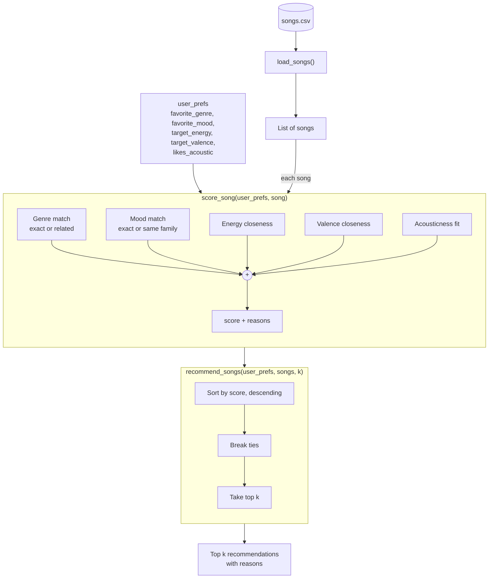

# 🎵 Music Recommender Simulation

## Project Summary

In this project you will build and explain a small music recommender system.

Your goal is to:

- Represent songs and a user "taste profile" as data
- Design a scoring rule that turns that data into recommendations
- Evaluate what your system gets right and wrong
- Reflect on how this mirrors real world AI recommenders

Replace this paragraph with your own summary of what your version does.

---

## How The System Works

### How real recommenders work

Platforms like Spotify and YouTube predict what you'll like next by combining
two approaches. **Collaborative filtering** learns from the behavior of many
users — plays, skips, saves, likes, playlist adds, watch time — and recommends
what people with similar habits enjoyed ("listeners like you also played…").
**Content-based filtering** describes each item by its own attributes — genre,
mood, tempo, energy, and audio features extracted from the sound itself — and
recommends items similar to what you already like. Real systems are hybrids:
collaborative filtering finds surprising connections, while content-based
filtering can recommend brand-new songs nobody has played yet (the "cold start"
problem).

Every recommender has three separate parts:

1. **Input data** – what the system knows about each song (its features).
2. **User preferences** – what the system knows about the listener (a taste
   profile, or at scale, their listening history).
3. **Ranking / selection** – how the system scores each song against the user
   and decides which ones to show, in what order.

### What my version does

My simulation is a **content-based** recommender. It has no other users to
learn from, so it compares each song's features directly against one user's
taste profile. It balances **how a song is labeled** (genre and mood, up to 4.5 points)
slightly above **how it sounds** (energy, valence, acousticness, up to 4.0
points). That way the numbers rank songs within a genre or mood, but a song
with no matching labels can't beat one that matches both. Energy and valence together capture a song's
"vibe": energy is how intense it feels, valence is how positive it feels.

### Features used

**`Song`**
- `genre` – category (pop, lofi, rock, …)
- `mood` – category (happy, chill, intense, …)
- `energy` – 0–1, how intense the song feels
- `valence` – 0–1, how positive/happy it sounds
- `acousticness` – 0–1, acoustic vs. electronic
- (`tempo_bpm` and `danceability` are kept in the data but not scored — in this
  dataset they are almost perfectly correlated with energy, so scoring them
  would count "intensity" several times.)

**`UserProfile`**
- `favorite_genre` – the genre they want
- `favorite_mood` – the mood they want
- `target_energy` – preferred energy level (0–1)
- `target_valence` – preferred positivity (0–1)
- `likes_acoustic` – True/False. If True, more acoustic songs earn more points; if False, more electronic (less acoustic) songs earn more points.

### Dataset

The catalog (`data/songs.csv`) started with 10 songs and was expanded to
**20 songs** to add missing genres (e.g., hip-hop, metal, folk, classical) and
moods (e.g., sad, angry, nostalgic), including low-valence songs the starter
data didn't have.

### Example user profile

```python
user_prefs = {
    "favorite_genre": "lofi",
    "favorite_mood": "chill",
    "target_energy": 0.40,
    "target_valence": 0.60,
    "likes_acoustic": True,
}
```

A calm, slightly positive, acoustic-leaning study listener.

### Algorithm Recipe

**Scoring Rule** (one song vs. one user, max 8.5 points):

| Feature | Points |
|---|---|
| Genre | +2.5 exact match · +1.25 related genre |
| Mood | +2.0 exact match · +1.0 same mood family |
| Energy | up to +2.0, based on closeness to the target |
| Valence | up to +1.5, based on closeness to the target |
| Acousticness | up to +0.5 → 0.5 × acousticness if `likes_acoustic`, else 0.5 × (1 − acousticness) |

Closeness uses a bell curve (Gaussian, σ = 0.20): a song near the user's target
gets nearly full points, and the score drops off quickly as the gap grows. This
rewards songs that are *close* to what the user wants, not simply higher or lower.

**Related genres** (partial credit): pop ↔ indie pop, rock ↔ metal,
lofi ↔ jazz, lofi ↔ ambient, electronic ↔ synthwave, folk ↔ country,
blues ↔ jazz, hip-hop ↔ r&b.

**Mood families** (partial credit): Calm (chill, relaxed, focused) ·
Bright (happy, carefree, hopeful) · Driven (energetic, intense, confident) ·
Low (sad, melancholy, moody) · Turbulent (angry, dramatic).

*Romantic* and *nostalgic* are intentionally left ungrouped: they're distinct
feelings, and grouping them would let someone who wants nostalgic folk get
romantic R&B.

**Why not the simpler +2 genre / +1 mood recipe?** In my data analysis, genre
labels were sparse (most genres have one song) and mood labels were inconsistent,
so I gave mood more weight and added valence and acousticness. That way the
system responds to how a song actually sounds, not just its tags.

**Ranking Rule** (all scored songs → final list):
1. Score every song in the catalog.
2. Sort from highest to lowest score.
3. Break ties by smallest energy distance, then by song id.
4. Return the top *k* songs (default 5), each with the reasons behind its score.

### Data flow



Example: for the profile above, *Library Rain* (lofi, chill, energy 0.35)
scores about **8.37 / 8.5**, while *Storm Runner* (rock, intense, energy 0.91)
scores about **1.38 / 8.5**.

### Expected biases

- **Genre imbalance:** lofi has the most songs *and* two related genres (jazz,
  ambient), so lofi listeners get many more good matches than others.
- **Unequal partial credit:** classical, reggae, and latin have no related
  genres, so fans of those get either one exact match or nothing.
- **Narrow profile:** a single `favorite_genre` means most songs earn 0 genre
  points. A user who likes two genres can't express that.
- **Double counting:** mood families and valence partly measure the same thing
  (a "sad" match plus low valence), so emotionally labeled songs get rewarded twice.
- **Conflicting preferences:** a user who wants "rock" but also "chill, low
  energy" may get no rock songs at all, because mood + energy outweigh genre.
- **Filter bubble:** nothing stops the top 5 from being all one genre or one
  artist. I plan to address this with a diversity rule in the ranking step.

---

## Getting Started

### Setup

1. Create a virtual environment (optional but recommended):

   ```bash
   python -m venv .venv
   source .venv/bin/activate      # Mac or Linux
   .venv\Scripts\activate         # Windows
   ```

2. Install dependencies

```bash
pip install -r requirements.txt
```

3. Run the app:

```bash
python -m src.main
```

### Running Tests

Run the starter tests with:

```bash
pytest
```

You can add more tests in `tests/test_recommender.py`.

---

## Sample Recommendation Output

Profile: genre=pop | mood=happy | energy=0.80 | valence=0.80 | acoustic=no
Loaded songs: 20

### Top 5 recommendations
======================================================
1. Sunrise City - Neon Echo                    Score: 8.37 / 8.5
     + genre match: pop (+2.50)
     + mood match: happy (+2.00)
     + energy 0.82 vs target 0.80 (+1.99)
     + valence 0.84 vs target 0.80 (+1.47)
     + acousticness 0.18, prefers non-acoustic (+0.41)
------------------------------------------------------
2. Rooftop Lights - Indigo Parade              Score: 7.04 / 8.5
     + related genre: indie pop ~ pop (+1.25)
     + mood match: happy (+2.00)
     + energy 0.76 vs target 0.80 (+1.96)
     + valence 0.81 vs target 0.80 (+1.50)
     + acousticness 0.35, prefers non-acoustic (+0.33)
------------------------------------------------------
3. Gym Hero - Max Pulse                        Score: 6.07 / 8.5
     + genre match: pop (+2.50)
     + no mood match: intense (+0.00)
     + energy 0.93 vs target 0.80 (+1.62)
     + valence 0.77 vs target 0.80 (+1.48)
     + acousticness 0.05, prefers non-acoustic (+0.47)
------------------------------------------------------
4. Island Slowdown - Roots Harbor              Score: 3.67 / 8.5
     + no genre match: reggae (+0.00)
     + mood family match: carefree ~ happy (+1.00)
     + energy 0.55 vs target 0.80 (+0.92)
     + valence 0.85 vs target 0.80 (+1.45)
     + acousticness 0.40, prefers non-acoustic (+0.30)
------------------------------------------------------
5. Fuego en la Plaza - Los Faroles             Score: 3.57 / 8.5
     + no genre match: latin (+0.00)
     + no mood match: energetic (+0.00)
     + energy 0.86 vs target 0.80 (+1.91)
     + valence 0.88 vs target 0.80 (+1.38)
     + acousticness 0.45, prefers non-acoustic (+0.28)

  - Sunrise City ranks first because it matches every preference. Rooftop Lights is
  second thanks to partial genre credit (indie pop ~ pop), and Gym Hero is still in
  the top 3 because its genre and energy match, even though its mood ("intense")
  doesn't.
---

## Experiments You Tried

### Profile results

I ran the recommender for 3 standard profiles and 4 edge-case profiles designed
to trick the scoring logic (`python -m src.main`). Full top-5 output for each:

#### 1. High-Energy Pop
```
######################################################
PROFILE: High-Energy Pop
genre=pop | mood=happy | energy=0.80 | valence=0.80 | acoustic=no
######################################################

Top 5 recommendations

======================================================
1. Sunrise City - Neon Echo                    Score: 8.37 / 8.5
     + genre match: pop (+2.50)
     + mood match: happy (+2.00)
     + energy 0.82 vs target 0.80 (+1.99)
     + valence 0.84 vs target 0.80 (+1.47)
     + acousticness 0.18, prefers non-acoustic (+0.41)
------------------------------------------------------
2. Rooftop Lights - Indigo Parade              Score: 7.04 / 8.5
     + related genre: indie pop ~ pop (+1.25)
     + mood match: happy (+2.00)
     + energy 0.76 vs target 0.80 (+1.96)
     + valence 0.81 vs target 0.80 (+1.50)
     + acousticness 0.35, prefers non-acoustic (+0.33)
------------------------------------------------------
3. Gym Hero - Max Pulse                        Score: 6.07 / 8.5
     + genre match: pop (+2.50)
     + no mood match: intense (+0.00)
     + energy 0.93 vs target 0.80 (+1.62)
     + valence 0.77 vs target 0.80 (+1.48)
     + acousticness 0.05, prefers non-acoustic (+0.47)
------------------------------------------------------
4. Island Slowdown - Roots Harbor              Score: 3.67 / 8.5
     + no genre match: reggae (+0.00)
     + mood family match: carefree ~ happy (+1.00)
     + energy 0.55 vs target 0.80 (+0.92)
     + valence 0.85 vs target 0.80 (+1.45)
     + acousticness 0.40, prefers non-acoustic (+0.30)
------------------------------------------------------
5. Fuego en la Plaza - Los Faroles             Score: 3.57 / 8.5
     + no genre match: latin (+0.00)
     + no mood match: energetic (+0.00)
     + energy 0.86 vs target 0.80 (+1.91)
     + valence 0.88 vs target 0.80 (+1.38)
     + acousticness 0.45, prefers non-acoustic (+0.28)
```

#### 2. Chill Lofi
```
######################################################
PROFILE: Chill Lofi
genre=lofi | mood=chill | energy=0.40 | valence=0.60 | acoustic=yes
######################################################

Top 5 recommendations
======================================================
1. Library Rain - Paper Lanterns               Score: 8.37 / 8.5
     + genre match: lofi (+2.50)
     + mood match: chill (+2.00)
     + energy 0.35 vs target 0.40 (+1.94)
     + valence 0.60 vs target 0.60 (+1.50)
     + acousticness 0.86, likes acoustic (+0.43)
------------------------------------------------------
2. Midnight Coding - LoRoom                    Score: 8.31 / 8.5
     + genre match: lofi (+2.50)
     + mood match: chill (+2.00)
     + energy 0.42 vs target 0.40 (+1.99)
     + valence 0.56 vs target 0.60 (+1.47)
     + acousticness 0.71, likes acoustic (+0.35)
------------------------------------------------------
3. Focus Flow - LoRoom                         Score: 7.39 / 8.5
     + genre match: lofi (+2.50)
     + mood family match: focused ~ chill (+1.00)
     + energy 0.40 vs target 0.40 (+2.00)
     + valence 0.59 vs target 0.60 (+1.50)
     + acousticness 0.78, likes acoustic (+0.39)
------------------------------------------------------
4. Spacewalk Thoughts - Orbit Bloom            Score: 6.83 / 8.5
     + related genre: ambient ~ lofi (+1.25)
     + mood match: chill (+2.00)
     + energy 0.28 vs target 0.40 (+1.67)
     + valence 0.65 vs target 0.60 (+1.45)
     + acousticness 0.92, likes acoustic (+0.46)
------------------------------------------------------
5. Coffee Shop Stories - Slow Stereo           Score: 5.97 / 8.5
     + related genre: jazz ~ lofi (+1.25)
     + mood family match: relaxed ~ chill (+1.00)
     + energy 0.37 vs target 0.40 (+1.98)
     + valence 0.71 vs target 0.60 (+1.29)
     + acousticness 0.89, likes acoustic (+0.45)

```

#### 3. Deep Intense Rock
```
######################################################
PROFILE: Deep Intense Rock
genre=rock | mood=intense | energy=0.90 | valence=0.40 | acoustic=no
######################################################

Top 5 recommendations
======================================================
1. Storm Runner - Voltline                     Score: 8.33 / 8.5
     + genre match: rock (+2.50)
     + mood match: intense (+2.00)
     + energy 0.91 vs target 0.90 (+2.00)
     + valence 0.48 vs target 0.40 (+1.38)
     + acousticness 0.10, prefers non-acoustic (+0.45)
------------------------------------------------------
2. Gym Hero - Max Pulse                        Score: 4.72 / 8.5
     + no genre match: pop (+0.00)
     + mood match: intense (+2.00)
     + energy 0.93 vs target 0.90 (+1.98)
     + valence 0.77 vs target 0.40 (+0.27)
     + acousticness 0.05, prefers non-acoustic (+0.47)
------------------------------------------------------
3. Ironclad Fury - Grave Circuit               Score: 4.43 / 8.5
     + related genre: metal ~ rock (+1.25)
     + no mood match: angry (+0.00)
     + energy 0.97 vs target 0.90 (+1.88)
     + valence 0.18 vs target 0.40 (+0.82)
     + acousticness 0.03, prefers non-acoustic (+0.48)
------------------------------------------------------
4. Concrete Psalms - Verse Theory              Score: 4.02 / 8.5
     + no genre match: hip-hop (+0.00)
     + mood family match: confident ~ intense (+1.00)
     + energy 0.80 vs target 0.90 (+1.76)
     + valence 0.62 vs target 0.40 (+0.82)
     + acousticness 0.12, prefers non-acoustic (+0.44)
------------------------------------------------------
5. Fuego en la Plaza - Los Faroles             Score: 3.32 / 8.5
     + no genre match: latin (+0.00)
     + mood family match: energetic ~ intense (+1.00)
     + energy 0.86 vs target 0.90 (+1.96)
     + valence 0.88 vs target 0.40 (+0.08)
     + acousticness 0.45, prefers non-acoustic (+0.28)

```

#### 4. Sad Banger (edge case)
```

######################################################
PROFILE: Sad Banger (edge case)
genre=blues | mood=sad | energy=0.90 | valence=0.20 | acoustic=no
######################################################

Top 5 recommendations
======================================================
1. Rust in the Rain - Delta Marrow             Score: 6.13 / 8.5
     + genre match: blues (+2.50)
     + mood match: sad (+2.00)
     + energy 0.33 vs target 0.90 (+0.03)
     + valence 0.22 vs target 0.20 (+1.49)
     + acousticness 0.78, prefers non-acoustic (+0.11)
------------------------------------------------------
2. Ironclad Fury - Grave Circuit               Score: 3.85 / 8.5
     + no genre match: metal (+0.00)
     + no mood match: angry (+0.00)
     + energy 0.97 vs target 0.90 (+1.88)
     + valence 0.18 vs target 0.20 (+1.49)
     + acousticness 0.03, prefers non-acoustic (+0.48)
------------------------------------------------------
3. Night Drive Loop - Neon Echo                Score: 3.42 / 8.5
     + no genre match: synthwave (+0.00)
     + mood family match: moody ~ sad (+1.00)
     + energy 0.75 vs target 0.90 (+1.51)
     + valence 0.49 vs target 0.20 (+0.52)
     + acousticness 0.22, prefers non-acoustic (+0.39)
------------------------------------------------------
4. Storm Runner - Voltline                     Score: 3.01 / 8.5
     + no genre match: rock (+0.00)
     + no mood match: intense (+0.00)
     + energy 0.91 vs target 0.90 (+2.00)
     + valence 0.48 vs target 0.20 (+0.56)
     + acousticness 0.10, prefers non-acoustic (+0.45)
------------------------------------------------------
5. Afterglow Static - Kaito Mere               Score: 2.86 / 8.5
     + no genre match: electronic (+0.00)
     + mood family match: melancholy ~ sad (+1.00)
     + energy 0.30 vs target 0.90 (+0.02)
     + valence 0.28 vs target 0.20 (+1.38)
     + acousticness 0.08, prefers non-acoustic (+0.46)

```

#### 5. Acoustic Chill Rock (edge case)
```
######################################################
PROFILE: Acoustic Chill Rock (edge case)
genre=rock | mood=chill | energy=0.20 | valence=0.60 | acoustic=yes
######################################################

Top 5 recommendations
======================================================
1. Spacewalk Thoughts - Orbit Bloom            Score: 5.76 / 8.5
     + no genre match: ambient (+0.00)
     + mood match: chill (+2.00)
     + energy 0.28 vs target 0.20 (+1.85)
     + valence 0.65 vs target 0.60 (+1.45)
     + acousticness 0.92, likes acoustic (+0.46)
------------------------------------------------------
2. Library Rain - Paper Lanterns               Score: 5.44 / 8.5
     + no genre match: lofi (+0.00)
     + mood match: chill (+2.00)
     + energy 0.35 vs target 0.20 (+1.51)
     + valence 0.60 vs target 0.60 (+1.50)
     + acousticness 0.86, likes acoustic (+0.43)
------------------------------------------------------
3. Midnight Coding - LoRoom                    Score: 4.91 / 8.5
     + no genre match: lofi (+0.00)
     + mood match: chill (+2.00)
     + energy 0.42 vs target 0.20 (+1.09)
     + valence 0.56 vs target 0.60 (+1.47)
     + acousticness 0.71, likes acoustic (+0.35)
------------------------------------------------------
4. Coffee Shop Stories - Slow Stereo           Score: 4.13 / 8.5
     + no genre match: jazz (+0.00)
     + mood family match: relaxed ~ chill (+1.00)
     + energy 0.37 vs target 0.20 (+1.39)
     + valence 0.71 vs target 0.60 (+1.29)
     + acousticness 0.89, likes acoustic (+0.45)
------------------------------------------------------
5. Focus Flow - LoRoom                         Score: 4.10 / 8.5
     + no genre match: lofi (+0.00)
     + mood family match: focused ~ chill (+1.00)
     + energy 0.40 vs target 0.20 (+1.21)
     + valence 0.59 vs target 0.60 (+1.50)
     + acousticness 0.78, likes acoustic (+0.39)
```

#### 6. Ghost Genre (edge case)
```
######################################################
PROFILE: Ghost Genre (edge case)
genre=k-pop | mood=happy | energy=0.80 | valence=0.80 | acoustic=no
######################################################

Top 5 recommendations
======================================================
1. Sunrise City - Neon Echo                    Score: 5.87 / 8.5
     + no genre match: pop (+0.00)
     + mood match: happy (+2.00)
     + energy 0.82 vs target 0.80 (+1.99)
     + valence 0.84 vs target 0.80 (+1.47)
     + acousticness 0.18, prefers non-acoustic (+0.41)
------------------------------------------------------
2. Rooftop Lights - Indigo Parade              Score: 5.79 / 8.5
     + no genre match: indie pop (+0.00)
     + mood match: happy (+2.00)
     + energy 0.76 vs target 0.80 (+1.96)
     + valence 0.81 vs target 0.80 (+1.50)
     + acousticness 0.35, prefers non-acoustic (+0.33)
------------------------------------------------------
3. Island Slowdown - Roots Harbor              Score: 3.67 / 8.5
     + no genre match: reggae (+0.00)
     + mood family match: carefree ~ happy (+1.00)
     + energy 0.55 vs target 0.80 (+0.92)
     + valence 0.85 vs target 0.80 (+1.45)
     + acousticness 0.40, prefers non-acoustic (+0.30)
------------------------------------------------------
4. Fuego en la Plaza - Los Faroles             Score: 3.57 / 8.5
     + no genre match: latin (+0.00)
     + no mood match: energetic (+0.00)
     + energy 0.86 vs target 0.80 (+1.91)
     + valence 0.88 vs target 0.80 (+1.38)
     + acousticness 0.45, prefers non-acoustic (+0.28)
------------------------------------------------------
5. Gym Hero - Max Pulse                        Score: 3.57 / 8.5
     + no genre match: pop (+0.00)
     + no mood match: intense (+0.00)
     + energy 0.93 vs target 0.80 (+1.62)
     + valence 0.77 vs target 0.80 (+1.48)
     + acousticness 0.05, prefers non-acoustic (+0.47)

```

#### 7. Silent Classical (edge case)
```
######################################################
PROFILE: Silent Classical (edge case)
genre=classical | mood=calm | energy=0.00 | valence=1.00 | acoustic=yes
######################################################

Top 5 recommendations
======================================================
1. Tempest Overture - Varga Chamber Ensemble   Score: 2.97 / 8.5
     + genre match: classical (+2.50)
     + no mood match: dramatic (+0.00)
     + energy 0.72 vs target 0.00 (+0.00)
     + valence 0.30 vs target 1.00 (+0.00)
     + acousticness 0.95, likes acoustic (+0.47)
------------------------------------------------------
2. Spacewalk Thoughts - Orbit Bloom            Score: 1.53 / 8.5
     + no genre match: ambient (+0.00)
     + no mood match: chill (+0.00)
     + energy 0.28 vs target 0.00 (+0.75)
     + valence 0.65 vs target 1.00 (+0.32)
     + acousticness 0.92, likes acoustic (+0.46)
------------------------------------------------------
3. Fuego en la Plaza - Los Faroles             Score: 1.48 / 8.5
     + no genre match: latin (+0.00)
     + no mood match: energetic (+0.00)
     + energy 0.86 vs target 0.00 (+0.00)
     + valence 0.88 vs target 1.00 (+1.25)
     + acousticness 0.45, likes acoustic (+0.23)
------------------------------------------------------
4. Island Slowdown - Roots Harbor              Score: 1.38 / 8.5
     + no genre match: reggae (+0.00)
     + no mood match: carefree (+0.00)
     + energy 0.55 vs target 0.00 (+0.05)
     + valence 0.85 vs target 1.00 (+1.13)
     + acousticness 0.40, likes acoustic (+0.20)
------------------------------------------------------
5. Coffee Shop Stories - Slow Stereo           Score: 1.33 / 8.5
     + no genre match: jazz (+0.00)
     + no mood match: relaxed (+0.00)
     + energy 0.37 vs target 0.00 (+0.36)
     + valence 0.71 vs target 1.00 (+0.52)
     + acousticness 0.89, likes acoustic (+0.45)


```


---

## Limitations and Risks

Summarize some limitations of your recommender.

Examples:

- It only works on a tiny catalog
- It does not understand lyrics or language
- It might over favor one genre or mood

You will go deeper on this in your model card.

---

## Reflection

Read and complete `model_card.md`:

[**Model Card**](model_card.md)

Write 1 to 2 paragraphs here about what you learned:

- about how recommenders turn data into predictions
- about where bias or unfairness could show up in systems like this


